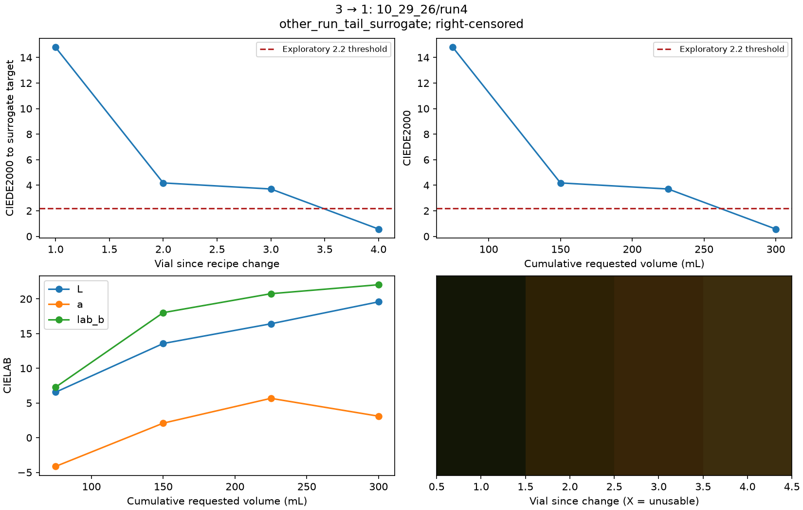
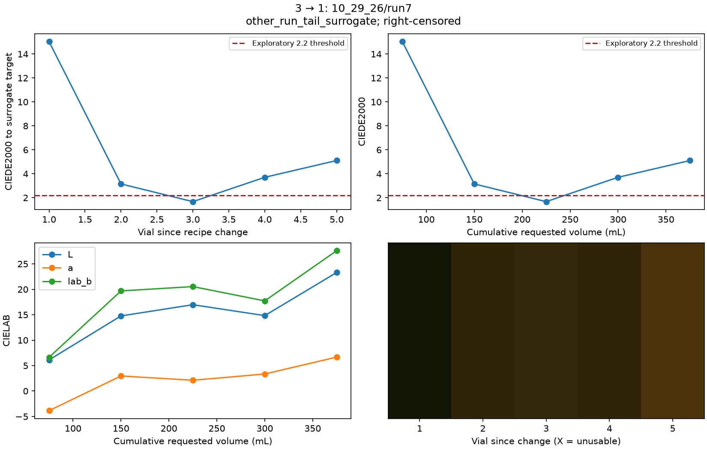

# October 29 collection: measured results and limits

Sources: `data/10_29_26/vial_filled/`, with labels committed in `a144f30` and
images/videos in `00bc374`. This analysis uses the real uploaded images, not
simulated colors or earlier video-5 calibration. Machine-readable results and
figures are committed under [`analysis/10_29_26`](../analysis/10_29_26/).

There are 27 vial labels, 1,187 frame labels/index entries and 1,187 JPEGs for
video ID 6. Three 640×480 recordings are present. The frame wall clock starts at
the timestamp string `2026-10-30 02:02:55.390000`; no timezone is assumed.

## A clock mismatch that changes which vial is inspected

The recordings last **1,956.3 container seconds**, but the image index spans
**2,372 wall-clock seconds**. The last vial ends at **2,128.61 wall-clock elapsed
seconds**. The first vial spans 112.61–141.61 on the label clock.

At video playback second 140 the burned-in clock reads **02:05:45.608**, while
the label/image clock at 140 reads about **02:05:15.390**. Directly seeking to
label seconds would select another part of the operation. This is not treated
as one fixed offset or rescaled blindly across camera gaps.

The workflow instead selects the nearest same-vial/same-recipe timestamped
still within the final 2.5 seconds of the labeled window. Source timestamps,
actual sample times and image hashes are saved; ROI contact sheets allow
alignment review. The video path rejects an unverified clock. Single stills
provide no temporal camera-repeatability evidence.

The [visual clock audit](../analysis/10_29_26/camera_clock_contact.png) checks all
26 sampled images against their burned-in timestamps and source hashes. The
vial-9 image is stale by **6.79 seconds** and is explicitly rejected; the other
25 timestamps match within the 0.5-second audit tolerance. A cached CSV makes
this audit reproducible without an external OCR installation.

## Available experimental units

| Run | Recipe | Requested composition per vial | Vials | Timed vials | Operator errors |
| --- | --- | --- | --- | --- | --- |
| 1 | 1 | T100 75 mL | 1–5 | 5 | 0 |
| 2 | 2 | T200 45 mL | 6–10 | 4 | 2 |
| 3 | 3 | T400 75 mL | 11–12 | 2 | 0 |
| 4 | 1 | T100 75 mL | 13–16 | 4 | 0 |
| 5 | 2 | T200 45 mL | 17–19 | 3 | 0 |
| 6 | 3 | T400 75 mL | 20–22 | 3 | 0 |
| 7 | 1 | T100 75 mL | 23–27 | 5 | 0 |

There are six changes in **one continuous recording session**:

| Directed transition | Occurrences | Independent recording sessions |
| --- | --- | --- |
| 1 → 2 | 2 | 1 |
| 2 → 3 | 2 | 1 |
| 3 → 1 | 2 | 1 |

The reverse directions 2 → 1, 3 → 2 and 1 → 3 are absent. More adjacent frames
do not establish independent sessions. There are three single-tank recipes and
**no mixed recipes** for validating a mixture model.

Vials 8 and 10 are labeled `error`. Vial 10 is unobservable during the stated
blackout and keeps missing times. Requested throughput after an error is
uncertain within that run; it is not treated as measured delivered volume.
The corrected time for vial 23 and estimated starts for vials 2/4 are preserved.

## Color measurement and observed recovery

Of 27 label rows, **26 have sampled images and 16 pass the measurement quality
checks**. Eleven rows are withheld: eight have clipped dark channels, one has
an uneven liquid patch, and two are operator errors (one also lacks an image
window). The stale vial-9 image also has a clipped channel; its additional clock
flag does not change the 16 usable readings. Diagnostics and rejected RGB
estimates are retained in the export.
The liquid ROI is `[300,335,324,370]` in the 640×480 camera, below the holder and
above the timestamp. The contact sheets show the sampled region on each vial.

No color chart or independent stable-vial repeatability study is supplied.
RGB/Lab and ΔE are therefore **camera-relative exploratory measurements**. The
identity correction cannot remove the warm camera/lighting response or recover
clipped channels. Comparisons to tank-camera colors are not assumed valid.

Clean references are explicitly labeled stable-tail **surrogates**. Target
vials from the same run are withheld from that run's evaluated curve. There is
no usable T200 clean target under the current clipping checks. The 3 → 1
transitions starting at vials 13 and 23 have initial exploratory differences of
approximately **14.94 and 15.23 ΔE00**, respectively, relative to the independent
run's T100 tail surrogate. Their trajectories are recorded in the figures:

**No transition has three consecutive usable observations below 2.2 ΔE00 to a
supported target.** All six are censored or unassessable under the stated rule.
This does not show that the physical system never clears: missing targets,
clipping, variable appearance and short follow-up prevent confirmation.
Consequently there is no defensible numerical longest-transition ranking.

## Model support and production status

The dataset does not support a general carryover fit: one session, missing
reverse directions, short follow-up and no independent clean references cannot
support held-out-session validation. No decay constant is fabricated.

The clean optical-density fitting code is implemented, but these images do not
supply verified clean control runs, independent blank controls or mixed-recipe
validation. Clipped channels cannot identify finite absorbance accurately.
Its artifact records `insufficient_data`, with no fitted coefficients.

Camera repeatability is **unproven**. Model uncertainty and production PASS/FAIL
remain disabled. The [workflow guide](transition_analysis.md) specifies the
chart, stable controls, clean mixtures and independent transitions needed to
advance those gates. The committed snapshot includes all six recovery plots,
the censored-transition heatmap, contact sheets and explicit model status.
