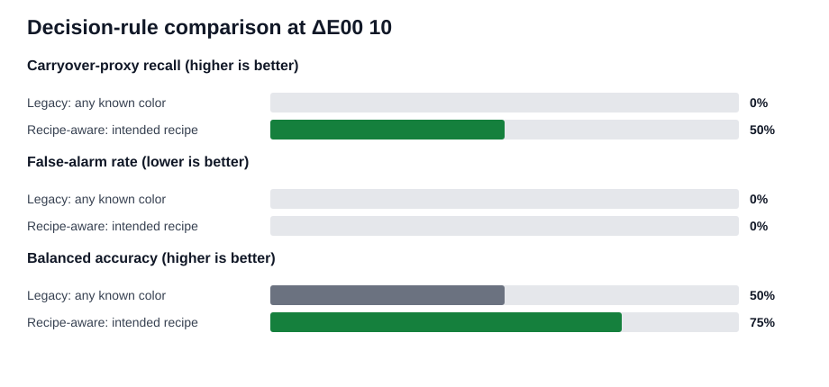

# Known-color vs. recipe-aware inspection

> **Scope:** this is a paired decision-logic benchmark on the one labeled real run. It is not a validation of the unfinished twin-trained prediction/advice pipeline, and it does not reproduce proprietary Teledyne hardware settings.

## Headline result

At the pre-existing shared project threshold of **ΔE00 = 10**, recipe-aware matching detected **4/8** transition-first-vial proxies, compared with **0/8** for the any-known-color emulation. That is a **+50 percentage-point** change in carryover-proxy recall. The false-alarm counts were **0/9** and **0/9**, respectively.



| Method | TP | FN | FP | TN | Carryover-proxy recall | Miss rate | False-alarm rate | Balanced accuracy | Proxy-label AUC |
|---|---:|---:|---:|---:|---:|---:|---:|---:|---:|
| Legacy: any known color | 0 | 8 | 0 | 9 | 0% | 100% | 0% | 50% | 0.44 |
| Recipe-aware: intended recipe | 4 | 4 | 0 | 9 | 50% | 50% | 0% | 75% | 0.90 |

## What changed between the methods

Both methods use exactly the same measured CIELAB colors, third-vial references, CIEDE2000 distance, threshold, and scored vials.

- **Legacy emulation:** passes when a vial resembles *any* known clean color. It can therefore accept the wrong recipe when that color is already in its database.
- **Recipe-aware baseline:** passes only when the vial resembles the clean reference for the recipe that was actually scheduled.

This isolates the value of recipe context. It does not attribute gains to different camera processing or a different threshold.

## Evaluation set

- Real `vial_fill_video_5.mp4`: 30 vials, 10 recipes, 3 vials per recipe.
- The third vial of each recipe is the documented clean-color reference and is not scored.
- The second vial is a clean proxy.
- The first vial after a known recipe change is a carryover-risk proxy; recipe 5 vial 1 is excluded because its preceding recipe is unknown.
- Coverage: **17/19 (89%)** planned cases; **9/10** recipes had a usable last-vial color measurement.

The supplied dataset has no independent good/bad or root-cause labels. These outcomes are process-derived proxies based on the event guide's documented carryover behavior.

## Measurement method

The runner reuses the repository's existing `color_monitor` measurement path: sample video 5 every 1 second, measure a fixed liquid ROI in CIELAB, segment physical vial cycles, and take the final sustained stable-color window. Cycles are matched to labels by production order. The measurement algorithm is identical for both decision rules.

Cycle audit: **30 observed cycles / 30 labels**. Observed cycle start minus labeled fill start had median **2.73 s** and maximum **19.98 s**. Lags above 10 s occurred for vial(s) **6, 29, 30**. The pairing is ordinal (cycle 1 to vial 1, and so on), so those timing outliers remain an explicit review item rather than hidden evidence.

## Threshold sensitivity

The primary result inherits the pre-existing `changeover_guard.contracts.COLOR_WARN_DE` value; it was not fitted or validated on this benchmark. The fixed sweep below prevents a conclusion based on one threshold.

| Threshold ΔE00 | Method | Carryover-proxy recall | False-alarm rate | Balanced accuracy |
|---:|---|---:|---:|---:|
| 2.3 | Legacy: any known color | 25% | 33% | 46% |
| 2.3 | Recipe-aware: intended recipe | 88% | 44% | 72% |
| 5 | Legacy: any known color | 0% | 11% | 44% |
| 5 | Recipe-aware: intended recipe | 88% | 11% | 88% |
| 10 | Legacy: any known color | 0% | 0% | 50% |
| 10 | Recipe-aware: intended recipe | 50% | 0% | 75% |

## Why the known-color rule misses transition vials

The following carryover-risk proxies passed the legacy rule at the primary threshold. `Nearest known recipe` shows which database color made the vial look acceptable.

| Vial | Transition | Nearest known recipe | Nearest ΔE00 | Intended-recipe ΔE00 | Recipe-aware decision |
|---:|---:|---:|---:|---:|---|
| 7 | 6->7 | 5 | 1.29 | 15.54 | FLAG |
| 10 | 7->8 | 7 | 1.89 | 14.64 | FLAG |
| 13 | 8->9 | 8 | 0.94 | 1.85 | PASS |
| 16 | 9->10 | 9 | 0.28 | 7.29 | PASS |
| 19 | 10->11 | 8 | 4.66 | 6.68 | PASS |
| 22 | 11->12 | 9 | 1.03 | 19.02 | FLAG |
| 25 | 12->13 | 12 | 3.59 | 8.85 | PASS |
| 28 | 13->14 | 13 | 1.99 | 15.81 | FLAG |

## Exclusions

| Vial | Recipe | Position | Expected outcome | Reason |
|---:|---:|---:|---|---|
| 4 | 6 | 1 | carryover-risk proxy | intended recipe has no usable last-vial reference (color measurement uncertain) |
| 5 | 6 | 2 | clean proxy | intended recipe has no usable last-vial reference (color measurement uncertain) |

## Planned metrics not yet claimable

| Metric | Status | What is missing |
|---|---|---|
| Leave-one-recipe-out generalization | Pending | Twin scenario sets exist (`twin/scenarios.py`), but no model trained on them is scored on real vials here. |
| First-vial prediction ΔE00 | Pending | `mixing.predict()` is still a stub; `carryover.py` forward predictions are not yet scored against real first vials. |
| Explanation correctness | Pending | `advise()` is still a stub and there are no independent cause labels. |
| Ordering-advice comparison | Separate | The queue optimizer is evaluated as a relative model score by `scripts/evaluate_optimization.py`; no measured-outcome labels exist to compare orderings. |

## Interpretation limits

- This emulates the documented *logic* of a known-color database; it is not a head-to-head test against the Teledyne system.
- References and test vials come from the same production run. The result shows the benefit of intended-recipe context, not cross-run robustness.
- There are only three vials per recipe. Confidence intervals would be too wide to support a production-accuracy claim.
- The last-vial method is an offline evaluation oracle. A deployed system must obtain expected colors from the digital twin or a separately validated reference set.

## Reproduce

```powershell
uv run python eval/compare.py --refresh
uv run pytest eval/test_compare.py
```

See `per_vial.csv`, `summary.csv`, `threshold_sensitivity.csv`, `references.csv`, `excluded.csv`, and `vial_measurements.meta.json` beside this report for the underlying evidence and cache provenance.
